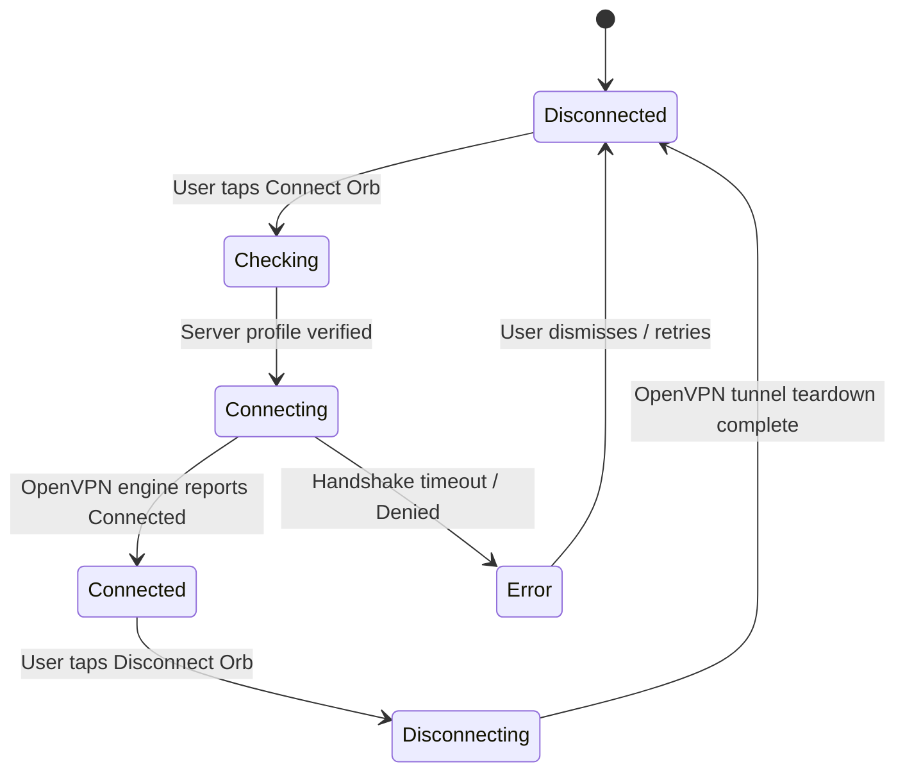

# ShieldRoute VPN — Architectural Blueprint (Clean Architecture)

## 1. Architectural Philosophy

ShieldRoute VPN is architected using **Uncle Bob's Clean Architecture** principles adapted for modern Flutter engineering. The architecture strictly enforces:
- **Independent Domain Layer**: Pure Dart entities, repository contracts, and single-responsibility use cases with zero framework, UI, or third-party package dependencies.
- **Data Abstraction**: Segregated data sources (`local/`, `remote/`, `platform/`), data models (DTOs), and repository implementations.
- **Inversion of Control**: High-level presentation logic depends only on domain abstractions.
- **Platform Isolation**: The OpenVPN engine is isolated behind `VpnPlatformDataSource`; Android VPN permission and TUN lifecycle are handled by the OpenVPN plugin.

```
┌─────────────────────────────────────────────────────────────────────────┐
│                           PRESENTATION LAYER                            │
│  Controllers: VpnController (ChangeNotifier / Provider data binding)    │
│  Views:       SplashView · WelcomeView · HomeView · ServersView         │
│               ActivityView · SettingsView · Privacy · Support           │
└────────────────────────────────────┬────────────────────────────────────┘
                                     │ Executes Use Cases
                                     ▼
┌─────────────────────────────────────────────────────────────────────────┐
│                             DOMAIN LAYER                                │
│  Entities:     VpnServer · VpnSession · AuthUser · VpnLiveMetrics       │
│                VpnConnectionState · ServerSortOption                    │
│  Use Cases:    ConnectVpn · DisconnectVpn · GetServers · DetectFastest  │
│                ToggleFavorite · Login · SignUp · GetSessionHistory ...  │
│  Contracts:    VpnRepository · ServerRepository · AuthRepository        │
│                PreferencesRepository · SessionRepository · Connectivity │
└────────────────────────────────────▲────────────────────────────────────┘
                                     │ Implements Contracts
                                     │
┌────────────────────────────────────┴────────────────────────────────────┐
│                              DATA LAYER                                 │
│  Repo Impls:   ServerRepositoryImpl · AuthRepositoryImpl                │
│                VpnRepositoryImpl · SessionRepositoryImpl                │
│                PreferencesRepositoryImpl · ConnectivityRepositoryImpl   │
│  Data Sources:                                                          │
│    - local:    PreferencesLocalDataSource · BundledSeedRelaysDataSource │
│    - remote:   ServerRemoteDataSource (VPN Gate HTTPS registry)         │
│    - platform: OpenVpnPlatformDataSource                               │
│                UnifiedVpnPlatformDataSource (OpenVPN coordinator)      │
│  Models / DTOs: VpnServerModel · VpnSessionModel · AuthUserModel        │
└────────────────────────────────────┬────────────────────────────────────┘
                                     │ OpenVPN plugin / Android VpnService / TUN
                                     ▼
┌─────────────────────────────────────────────────────────────────────────┐
│                    ANDROID VPNSERVICE SUBSYSTEM                         │
│             OpenVPN plugin service · Android TUN interface              │
└─────────────────────────────────────────────────────────────────────────┘
```

---

## 2. Connection State Machine

The client state machine enforces strict integrity. The application never transitions to `connected` solely because the connect action was triggered.



### State Semantics
| State | Presentation | Visual Token |
|---|---|---|
| `disconnected` | Status badge "UNPROTECTED", Power icon | Ink Navy 6% badge, White icon |
| `checking` | Status badge "CONNECTING...", Orb sweep | Animated 360-degree stroke sweep |
| `connecting` | Status badge "CONNECTING...", Sync icon | Animated sweep at 1.2s cadence |
| `connected` | Status badge "PROTECTED", Shield icon | Signal Lime (`#C7F000`) pip |
| `disconnecting` | Status badge "DISCONNECTING..." | In-transit teardown |
| `error` | Status banner with explicit diagnosis & Retry | Error Red (`#BA1A1A`) |

---

## 3. Directory Structure

```
lib/
├── main.dart                                   # Dependency injection & MultiProvider wiring
├── app/
│   ├── app.dart                                # MaterialApp configuration & theme registration
│   ├── router.dart                             # Explicit named route table
│   └── theme/
│       ├── app_colors.dart                     # Quiet Bastion & Cyber Dark palette tokens
│       ├── app_text_styles.dart                # Typographic scale & tracking
│       └── app_theme.dart                      # Material 3 ThemeData definition
│
├── core/
│   ├── constants/app_constants.dart            # Storage keys, disclosure copy, URLs
│   ├── errors/                                 # VpnException & Failure domain representations
│   │   ├── exceptions.dart
│   │   ├── failures.dart
│   │   └── vpn_exception.dart
│   ├── storage/preferences_service.dart        # Clean preferences wrapper
│   └── usecase/usecase.dart                    # Clean Architecture base UseCase contracts
│
├── domain/                                     # Pure business logic (Zero external dependencies)
│   ├── entities/
│   │   ├── auth_user.dart                      # User profile entity
│   │   ├── server_sort_option.dart             # Sorting criteria enum
│   │   ├── vpn_connection_state.dart           # Connection state enum
│   │   ├── vpn_live_metrics.dart               # Real-time throughput metrics
│   │   ├── vpn_server.dart                     # VPN relay node entity
│   │   └── vpn_session.dart                    # Connection session entity
│   ├── repositories/
│   │   ├── auth_repository.dart                # Auth contract
│   │   ├── connectivity_repository.dart        # Network monitoring contract
│   │   ├── preferences_repository.dart         # Preferences storage contract
│   │   ├── server_repository.dart              # Relay discovery & benchmarking contract
│   │   ├── session_repository.dart             # History logging contract
│   │   └── vpn_repository.dart                 # VPN tunnel operation contract
│   └── usecases/
│       ├── auth/                               # Login, SignUp, GuestLogin, SignOut
│       ├── servers/                            # GetServers, DetectFastest, ToggleFavorite, Probe
│       ├── sessions/                           # GetHistory, SaveSession, ClearHistory
│       └── vpn/                                # Connect, Disconnect, StateStream, MetricsStream
│
├── data/                                       # Data Layer implementations & platform adapters
│   ├── datasources/
│   │   ├── local/
│   │   │   ├── bundled_seed_relays_data_source.dart # Snapshot of official VPN Gate relays
│   │   │   └── preferences_local_data_source.dart   # SharedPreferences persistence
│   │   ├── remote/
│   │   │   └── server_remote_data_source.dart       # VPN Gate HTTPS registry and probes
│   │   └── platform/
│   │       ├── vpn_platform_data_source.dart        # Platform engine abstraction
│   │       ├── native_vpn_platform_data_source.dart # SSTP tunnel (ShieldRouteVpnService)
│   │       ├── openvpn_platform_data_source.dart    # axevpn_flutter OpenVPN driver
│   │       └── unified_vpn_platform_data_source.dart# SSTP first, OpenVPN fallback
│   ├── models/
│   │   ├── auth_user_model.dart                # Auth DTO
│   │   ├── vpn_server_model.dart               # Server node DTO
│   │   └── vpn_session_model.dart              # Session DTO
│   └── repositories/
│       ├── auth_repository_impl.dart
│       ├── connectivity_repository_impl.dart
│       ├── preferences_repository_impl.dart
│       ├── server_repository_impl.dart
│       ├── session_repository_impl.dart
│       └── vpn_repository_impl.dart
│
├── presentation/
│   └── controllers/
│       └── vpn_controller.dart                 # Reactive state controller for UI
│
├── features/                                   # Presentation Views & Reusable Widgets
│   ├── common/                                 # Visual design components
│   ├── splash/                                 # Animated brand splash view
│   ├── onboarding/                             # Welcome & VPN disclosure views
│   ├── auth/                                   # Login, SignUp, ForgotPassword
│   ├── home/                                   # HomeView & MainNavigationShell
│   ├── servers/                                # ServersView & ServerDetailsSheet
│   ├── activity/                               # ActivityView & SessionDetailsSheet
│   ├── settings/                               # SettingsView & ProfileView
│   ├── privacy/                                # PrivacyCenterView & LegalViews
│   └── support/                                # FaqView, ReportProblemView, AboutView
│
└── services/                                   # Backward-compatible service adapters
    ├── auth_service.dart
    ├── connectivity_service.dart
    ├── native_vpn_service.dart
    ├── openvpn_service.dart
    ├── server_service.dart
    ├── unified_vpn_service.dart
    └── vpn_service.dart
```
